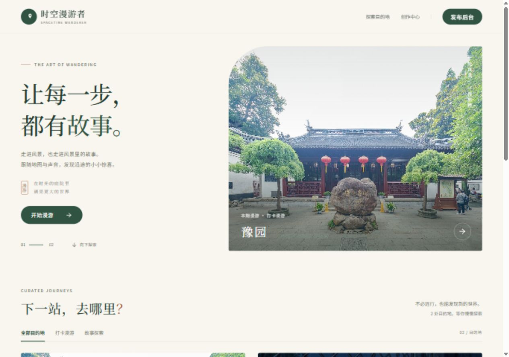
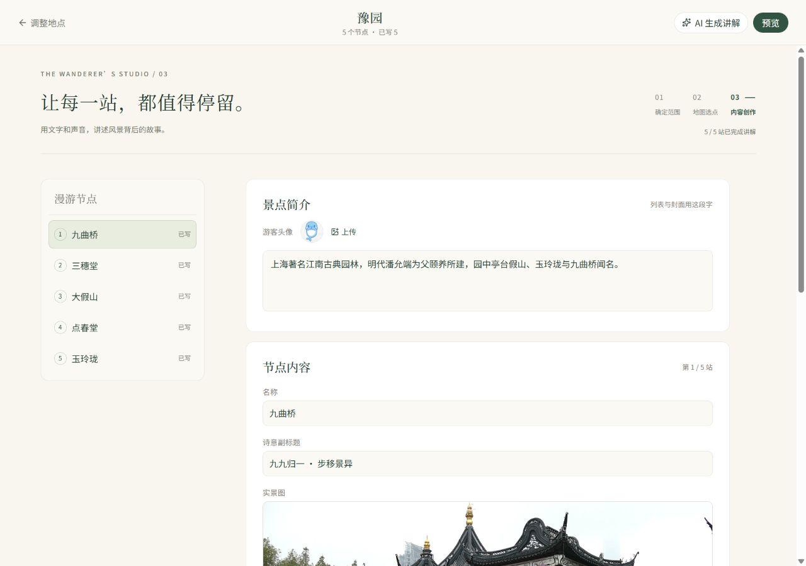
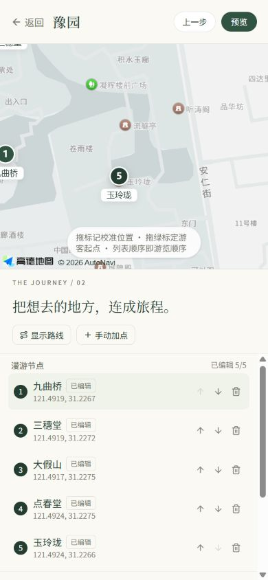
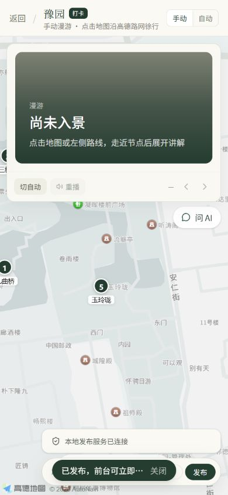

# 时空漫游者 · Spacetime Wanderer

**让每一步，都有故事。**

一个集地图漫游、语音讲解、分支故事与内容创作于一体的 Web 应用。游客可以沿路线打卡，也可以在故事路口选择下一站；创作者可以从地图选点开始，完成文案、配图、预览与在线发布。

采用暖白、深绿与陶土色的旅行杂志风格，覆盖首页、漫游、地图编辑和内容创作页面，并适配桌面与手机。

[页面预览](#页面预览) · [快速开始](#快速开始) · [创作与发布](#创作与发布) · [Docker 部署](#docker-部署) · [配置说明](#配置说明)

## 主要功能

- **两种漫游方式**：打卡模式按路线依次游览；故事模式支持入口、分支、选择与多个结局。
- **地图与讲解**：高德地图展示景点、游客位置和步行路线，支持手动移动与自动导览、浏览器语音讲解。
- **内容工作台**：检索景区和周边 POI、调整节点坐标、设置游客起点、编辑讲解与故事关系。
- **AI 辅助创作**：分段生成景点简介、节点讲解和故事内容，也支持游客问答；需要配置兼容的模型接口。
- **预览与发布**：直接使用游客端页面预览草稿，上传图片后提交发布包，成功后立即在前台查看。
- **内容管理**：发布口令授权、景点回收站与恢复、Docker 持久化存储。

仓库包含两套示例：**豫园**（5 个打卡节点）和 **红山动物园**（10 个故事节点）。

## 页面预览

以下均为本地实际页面截图。桌面截图限制展示宽度为 920 px，手机截图为 280 px；四张图片合计约 210 KiB，点击可查看原图。

### 首页 · 旅行杂志式目的地探索

<a href="docs/images/home-desktop.jpg">
  
</a>

### 内容创作 · 节点导航与讲解编辑

<a href="docs/images/content-studio-desktop.jpg">
  
</a>

### 手机端 · 地图编辑与发布成功

地图编辑采用上方地图、下方节点列表的布局；预览页可以直接完成发布。

<p>
  <a href="docs/images/map-editor-mobile.jpg"></a>
  &nbsp;&nbsp;
  <a href="docs/images/publish-success-mobile.jpg"></a>
</p>

## 快速开始

### 1. 准备环境

需要 **Node.js 24** 和 npm。地图功能需要高德 Web 端 JS API Key 与安全密钥；AI 功能需要模型接口配置。

在项目根目录执行：

```bash
npm ci
cp .env.example .env
```

Windows PowerShell 可将第二行替换为：

```powershell
Copy-Item .env.example .env
```

按下方[配置说明](#配置说明)填写 `.env`，再选择运行方式。

### 2. 开发模式

```bash
npm run dev
```

打开 [http://localhost:5173](http://localhost:5173)。Vite 中间件提供本地发布接口，适合修改页面和创作示例内容。

### 3. 正式服务模式

```bash
npm run build
npm start
```

打开 [http://127.0.0.1:3001](http://127.0.0.1:3001)。Node 服务同时提供页面、发布 API 和公开景点数据，无需安装额外的服务端依赖，默认只监听本机。

> `npm run preview` 仅用于静态产物预览。要验证完整发布流程，请使用 `npm start`。

## 创作与发布

1. 进入首页的「发布后台」，新建景点。
2. 填写目的地、城市与漫游模式，检索并勾选候选地点。
3. 在地图上调整节点位置、游客起点与游览顺序；故事模式可设置分支、入口和结局。
4. 进入「内容创作」，手动编辑或使用 AI 生成讲解，上传图片与游客头像。
5. 点击「预览」检查游客实际体验。所有节点完成文案、故事结构通过校验后，即可发布。
6. 配置了发布口令时，先在管理页或预览页完成授权，再点击「发布」。
7. 后端确认成功后，点击「去前台看」。失败会显示原因，草稿保留，不会自动下载 JSON 或提前标记成功。

已发布景点可移入回收站，再从管理页底部恢复。若已存在同 ID 的景点或图片目录，恢复会拒绝覆盖，保留回收记录。

### 数据保存在哪里

| 内容 | 开发模式 | 正式服务 |
| --- | --- | --- |
| 已发布目录、景点包与图片 | `public/spots/` | `data/spots/` |
| 回收站 | `.trash/spots/` | `data/trash/` |
| 编辑中的草稿 | 当前浏览器 localStorage | 当前浏览器 localStorage |
| 发布授权 | 当前标签页 sessionStorage | 当前标签页 sessionStorage |

正式服务首次启动时，从 `dist/spots/` 初始化内容；已有目录后，不再用构建产物覆盖数据。因此更新页面代码或重启服务不会重置已发布内容。

**开发与正式服务的数据相互独立。** 正式服务发布后的内容以 `data/` 为准；草稿没有云端同步，换浏览器或访问地址不会自动带入。

## Docker 部署

适用于 CentOS / Linux 与 1Panel。默认部署为一个 Node 容器，宿主端口为 **8080**，容器内部端口为 **3001**。

### 1. 本地构建

填写前端配置后执行：

```bash
npm run build
```

将以下内容放到服务器同一目录：

```text
dist/
server/
Dockerfile
docker-compose.yml
.dockerignore
```

镜像直接复制构建产物，服务器不需要安装 Node 或重新构建前端。`server/*.test.mjs` 不会进入镜像。

### 2. 设置发布口令

在服务器部署目录创建 `.env`：

```dotenv
PUBLISH_ADMIN_TOKEN=替换为你自己的至少24位随机长口令
```

可以在本机生成随机口令后填入：

```bash
node -e "console.log(require('node:crypto').randomBytes(32).toString('hex'))"
```

不要把发布口令放入任何 `VITE_*` 变量。生产模式或对外监听时，口令未设置、长度不足 24 位会导致服务拒绝启动。

### 3. 启动与访问

```bash
docker compose up -d --build
docker compose logs -f web
```

访问 `http://服务器IP:8080`。若使用 1Panel / OpenResty，反向代理上游设为 `http://127.0.0.1:8080`，允许至少 **16 MB** 请求体；公网使用 HTTPS，并在高德控制台放行访问域名。

游客查看无需发布口令。创作者在发布页面输入口令，完成当前标签页的授权后即可管理内容。

### 持久化与备份

- Compose 使用 `publish-data` 命名卷保存 `spots` 与 `trash`，实际卷名通常带项目名前缀。
- 重建镜像和普通 `docker compose down` 会保留数据；**不要使用 `docker compose down -v`，该命令会删除数据卷。**
- 备份前停止写入或停止容器，完整备份数据卷。迁移已有景点时，包、目录和图片需要一起迁移。
- 修改镜像内的 `dist/spots` 不会覆盖已有卷，请通过发布页面更新内容。
- 一个数据目录只由一个 Node 进程管理，不支持多个后端实例同时写入同一个卷。

`nginx.conf` 保留给自定义 Nginx 前置部署，会把管理 API 与景点数据转发至 `backend:3001`；默认 Compose 无需 Nginx 容器。

当前 Docker 配置尚未在本机运行验证；Node 服务及其发布流程已完成本地验证。

## 配置说明

### 前端构建配置

| 变量 | 用途 |
| --- | --- |
| `VITE_AMAP_KEY` | 高德 Web 端 JS API Key |
| `VITE_AMAP_SECURITY_CODE` | 高德 JS API 安全密钥 |
| `VITE_DEEPSEEK_BASE_URL` | 兼容 Chat Completions 的模型服务地址 |
| `VITE_DEEPSEEK_API_KEY` | 现有浏览器直连模型接口使用的 Key |
| `VITE_DEEPSEEK_MODEL` | 模型名称，需与端点支持的名称一致 |

**所有 `VITE_*` 配置都会进入前端产物。** 当前 AI 调用仍是浏览器直连，尚未实现服务端 AI 代理，不适合在其中配置要求保密的长期密钥。

### 服务端运行配置

| 变量 | 默认值 / 说明 |
| --- | --- |
| `PUBLISH_ADMIN_TOKEN` | 发布管理口令；生产或对外监听时必填，至少 24 位 |
| `HOST` | 本地 `127.0.0.1`；Docker 内 `0.0.0.0` |
| `PORT` | `3001` |
| `DATA_DIR` | 项目下的 `data/`；Docker 内 `/app/data` |
| `STATIC_DIR` | 项目下的 `dist/` |

`npm start` 自动读取根目录 `.env`。Docker Compose 将发布口令传入容器，其他默认值由镜像配置。

## 技术栈与目录

- **前端**：React 19、TypeScript 6、Vite 8、React Router 7、Tailwind CSS 4、Lucide。
- **地图与语音**：高德地图 JS API、浏览器 Speech Synthesis。
- **后端**：Node.js 原生 HTTP 与文件系统 API；JSON 发布包、图片文件和回收站。
- **部署**：Docker Compose、持久化卷；可接入 1Panel / OpenResty。

```text
src/
  pages/                  首页、漫游、发布管理与预览
    content/              打卡与故事内容创作
  components/             地图、讲解、授权与创作共用组件
  lib/                    发布契约、草稿、AI、地图及故事逻辑
server/
  index.mjs               页面、公开数据与 API 服务入口
  publishing.mjs          授权、上传、校验、发布、回收与恢复
  publishing.test.mjs     独立临时数据的后端集成测试
public/spots/             开发模式数据与初始示例
docs/
  images/                 README 实际截图
  note/                   功能演进与历史部署记录
data/                     正式服务数据，不进入 Git
vite-plugin-export-to-display.ts
                          开发态复用正式发布实现
```

## 接口与限制

公开数据通过 `GET /spots/catalog.json`、`GET /spots/<id>.json` 和图片路径读取，响应带 `no-cache`。

除健康检查与授权状态外，管理接口需要 `Authorization: Bearer <PUBLISH_ADMIN_TOKEN>`；未配置口令的本机开发服务例外。

| 方法 | 路径 | 用途 |
| --- | --- | --- |
| GET | `/__trip_guide/health` | 健康检查 |
| GET | `/__trip_guide/auth` | 授权要求与当前口令状态 |
| POST | `/__trip_guide/media?path=<景点ID/图片文件名>` | 上传图片 |
| POST | `/__trip_guide/export` | 提交 JSON `{ "package": ... }` |
| DELETE | `/__trip_guide/spot?id=<景点ID>` | 移入回收站 |
| GET | `/__trip_guide/trash` | 查询回收站 |
| POST | `/__trip_guide/trash/restore?folder=<回收记录>` | 恢复景点 |

图片支持 JPEG、PNG、WebP、GIF，单文件上限 **15 MiB**；发布 JSON 上限 **4 MiB**。后端校验 ID、路径、坐标、讲解内容、图片存在性和故事可达性。

图片采用不可变文件名，同名不同内容的上传会被拒绝。未完成发布留下的图片不自动清理。JSON 使用临时文件写入后原子替换，目录更新在单进程内串行执行。这里不包含账号体系、云端草稿同步或多实例事务存储。

## 检查与验证

```bash
npm run test:server
npm run build
npm run lint
```

后端有 10 项集成测试，覆盖授权、上传与发布、非法输入、不可变图片、并发目录更新、删除恢复、重启持久化、故事结构和写入失败回滚。测试使用独立临时目录，不改动实际景点数据。

本地浏览器已验证实际发布成功、前台立即读取、授权与退出，以及桌面和手机创作界面。代码检查当前保留 9 条既有地图组件警告。
